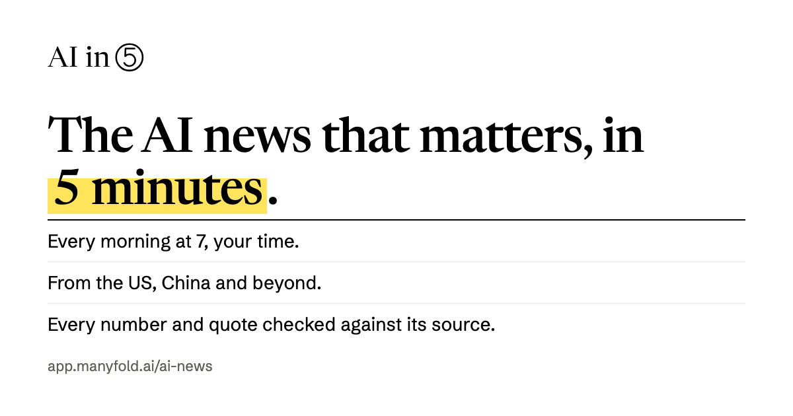

# AI in 5

English · [中文](README_CN.md)

**Every morning at 7, the AI news that matters, from the US, China and beyond, in about five minutes.**
Written by AI agents, with every number and quote checked against its source. In English and Chinese, on the web and by email.

**Read it:** [app.manyfold.ai/ai-news](https://app.manyfold.ai/ai-news)

[](https://app.manyfold.ai/ai-news)

## What readers get

- **One issue a day, with an end.** "Today in 3" up top, a handful of stories, a few briefs. At most ten items and about a thousand words; on a thin day, fewer.
- **East and West.** Stories from US, Chinese and European labs, companies and regulators, read in their original language.
- **Checkable.** Every story links its sources and says whether each is official, reported or a rumor. A highlighted number is one that was matched against the source by code: tap it to see the original wording.
- **Two languages.** English is the master copy; the Chinese edition is translated and checked so that numbers, names and links match. Each language has its own URLs.
- **Email at 7:00 local time.** Double opt-in, the whole issue in the email, one-click unsubscribe, no tracking pixels.
- **Ask about a story.** Subscribers can ask their own questions; answers come only from that story's sources, every sentence cited, or say plainly that the sources don't cover it.
- **Corrections in the open.** A corrected story is marked with what changed; a withdrawn one leaves a notice. All of them are on the [corrections page](https://app.manyfold.ai/ai-news/en/corrections) and in the next email.

## How an issue is made

Nobody writes or reviews an issue by hand. A pipeline does it every evening, and code, not AI, has the last word on facts.

```
19:30 UTC  collect   official newsrooms, labs and leading outlets (RSS and newsroom pages)
           pick      writer agent chooses the stories                         ← billed turn 1
           fetch     the original pages, kept as snapshots for checking
           write     writer agent drafts the English master                    ← billed turn 2
           check 1   code: every quote must be in its source, every number too
           check 2   a different agent, on a different model family, reviews   ← billed turn 3
                     each claim against the sources; its fixes go through check 1 again
           translate writer agent writes the Chinese edition                   ← billed turn 4
           check 3   code: numbers, names and links match across languages
           publish   only what passed all three checks; anything that failed is cut
20:30 UTC  retry     once, only if the 19:30 run failed
07:00 local          email to each subscriber in their own time zone
```

Three agents run on [Manyfold](https://manyfold.ai), each in its own sandbox: the **writer** (picks, writes, translates), the **reviewer** (check 2; no web access, judges only the sources it is given) and the **answerer** (readers' questions; every tool denied, never sees a reader's address). The owner gets an email when a run fails, when an issue is published (with a warning on a thin day) and when a reader reports a problem, and spot-checks issues from `/admin`.

The product plan, in Chinese, is in [docs/product-plan.md](docs/product-plan.md); the design system and prototypes are in [docs/design/](docs/design/).

## Privacy

No cookies, no ads, no third-party tracking. Subscribers' addresses are never logged and never returned by any API; reading counts are daily totals. Unconfirmed, unsubscribed and bounced addresses are deleted after 30 days, and "Unsubscribe and delete my data" deletes everything at once. The full policy: [app.manyfold.ai/ai-news/en/privacy](https://app.manyfold.ai/ai-news/en/privacy).

## How it is built

One Cloudflare Worker serves everything below `app.manyfold.ai/ai-news`:

```
Browser ── pages ──► Worker: index.html with each page's title, share card and status (pages.ts)
        ── /api ───► Hono app (src/worker/index.ts)
                       reader routes   published issues, subscribe, ask, report, counters
                       admin routes    behind ADMIN_PASSWORD: issues, quality, stats, email, agents
Cron 19:30 / 20:30 ─► pipeline (src/worker/pipeline/), then data retention (retention.ts)
Cron every 15 min ──► email delivery at 07:00 local (src/worker/email/)
Queue aiin5-ask ────► readers' questions to the answerer (src/worker/ask/)
                     D1 (src/worker/db.ts) · Resend · Turnstile · Manyfold A2A
```

| Path | What it is |
| --- | --- |
| `src/app/reader/` | The reader: issue, archive, about, corrections, privacy, ask sheet |
| `src/app/` (rest) | The owner's console at `/admin` (reached by URL only) |
| `src/shared/issue.ts` | The issue format, its validator, and corrections |
| `src/worker/pipeline/` | Collect, pick, write, three checks, translate, publish |
| `src/worker/ask/` | Readers' questions and the check every answer must pass |
| `src/worker/email/` | Rendering, sending, signed links, bounce webhook |
| `src/worker/quality.ts` | Corrections, reports, the owner's checks, the launch gate |
| `src/worker/pages.ts` | Server-side tags for every page, the sitemap |
| `AGENTS.md` | The rules any change must keep: read it before changing anything |

Vite, React 19, Hono, D1, no ORM, no migrations: the schema in `src/worker/db.ts` is applied on the first request.

## Running it locally

```bash
npm install
cp .dev.vars.example .dev.vars
npm run dev
```

The dev server runs the React app and the Worker together, with a local D1 database and a fictional sample issue. Open http://localhost:5173/ai-news/ for the reader and http://localhost:5173/ai-news/admin for the console. Emails are logged, not sent, until `RESEND_API_KEY` and `EMAIL_FROM` are set.

| Command | What it does |
| --- | --- |
| `npm run dev` | App, Worker and local D1 |
| `npm test` | Unit tests (vitest) |
| `npm run check` | Typecheck, build, `wrangler deploy --dry-run` |
| `npm run smoke -- <url>` | Smoke-test a deployment |
| `node scripts/og-cards.mjs` | Re-render the share cards (needs Chrome) |

## Configuration

Variables live in `wrangler.jsonc`; secrets are set with `npx wrangler secret put NAME` and never committed (`.dev.vars` is git-ignored).

| Name | Kind | Purpose |
| --- | --- | --- |
| `SITE_URL` | var | The public site, base path included |
| `EMAIL_POSTAL_ADDRESS`, `CONTACT_EMAIL` | var | Publisher's address in every email; Reply-To and privacy contact |
| `TURNSTILE_SITE_KEY` | var | Bot check on the subscribe form |
| `ADMIN_PASSWORD` | secret | Locks `/admin` and the admin API |
| `RESEND_API_KEY`, `EMAIL_FROM` | secret | Sending email |
| `RESEND_WEBHOOK_SECRET` | secret | Verifies bounce and complaint webhooks |
| `TURNSTILE_SECRET_KEY` | secret | Verifies the bot check |
| `CONFIG_ENCRYPTION_KEY` | secret | Optional key for the agent tokens sealed in D1 |

## Deploying

Production is the `manyfold-ai-news` Worker on the NetMind.AI Cloudflare account, routed at `app.manyfold.ai/ai-news`. Pushing to GitHub does **not** deploy. From a clean checkout of `main`:

```bash
npm ci
npm run check
npm test
npm run build
npx wrangler deploy
npm run smoke -- https://app.manyfold.ai/ai-news
```

The first request after a deploy can return 530 while the route propagates; the smoke test waits for it.

## Security

Agent tokens and the Manyfold device code are AES-GCM sealed in D1 and never reach the browser; agent URLs pass an SSRF guard; connectivity checks never bill; every billed turn's message id is derived from a stored row, so a retry cannot bill twice. To report a vulnerability, see [SECURITY.md](SECURITY.md).

## License

[MIT](LICENSE). Built on the [Manyfold Cloudflare Worker starter](https://github.com/manyfold-open/cloudflare-worker-starter).
