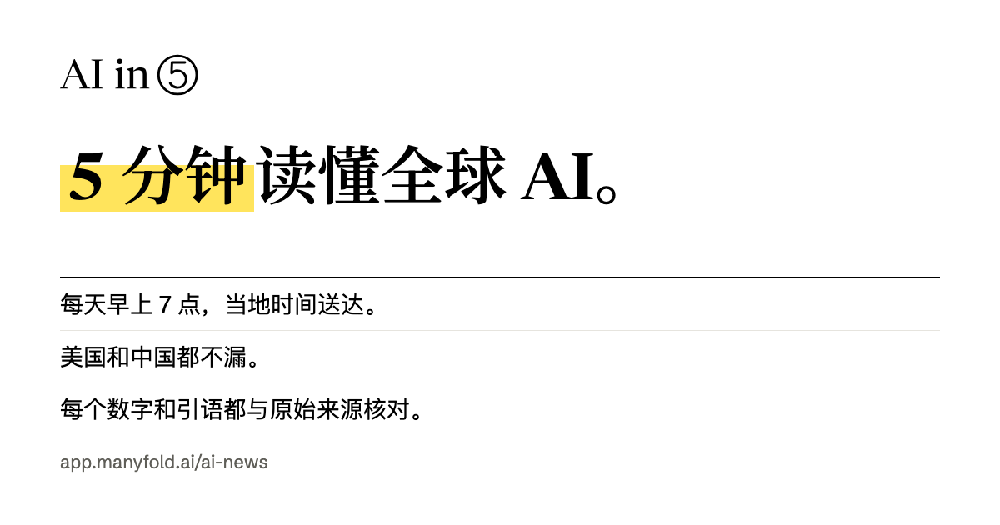

# AI in 5

[English](README.md) · 中文

**每天早上 7 点，5 分钟读懂全球 AI，美国和中国都不漏。**
由 AI 智能体撰写，每个数字和引语都与原始来源核对。中英双语，网站和邮件都能看。

**阅读地址：** [app.manyfold.ai/ai-news](https://app.manyfold.ai/ai-news/zh/)

[](https://app.manyfold.ai/ai-news/zh/)

## 读者能得到什么

- **每天一期，读完就结束。** 开头是"今日三件事"，然后是几条要闻和几条快讯。每期最多 10 条、约 1,000 个英文单词；新闻少的日子就少发几条，不凑数。
- **中美都覆盖。** 美国、中国和欧洲的实验室、公司和监管机构的动态，按原文语言阅读。
- **每条都能核对。** 每条新闻都附来源，并标明是官方、媒体报道还是传闻。荧光笔划出的数字已由程序与原文比对，点一下就能看到原话。
- **中英双语。** 英文是母版，中文由 AI 翻译，并核对数字、名称和链接与英文版一致。两种语言各有独立网址。
- **当地时间早上 7 点发邮件。** 双重确认订阅，邮件里就是完整的一期，一键退订，没有追踪像素。
- **就新闻提问。** 订阅者可以自己提问；回答只依据这条新闻的来源，每句话都附出处，来源里没有的会直接说明。
- **公开更正。** 更正过的新闻会标注改了什么；撤下的会留下说明。全部列在[更正记录页](https://app.manyfold.ai/ai-news/zh/corrections)，并在下一封邮件里告诉订阅者。

## 一期是怎么做出来的

没有人手工撰写或逐期审稿。每天傍晚由流水线完成，事实的最终判断由程序而不是 AI 来做。

```
19:30 UTC  采集      官方新闻室、实验室和一线媒体（RSS 和新闻页面）
           选题      写稿智能体挑选新闻                                   ← 计费回合 1
           抓取      原文页面，存成快照用于核对
           撰写      写稿智能体写英文母版                                 ← 计费回合 2
           第一道    程序：每段引语、每个数字都必须在原文里找到
           第二道    另一个智能体（不同模型家族）对照原文逐条审核          ← 计费回合 3
                     它的修改会再过一遍第一道审核
           翻译      写稿智能体写中文版                                   ← 计费回合 4
           第三道    程序：中英文的数字、名称和链接必须一致
           发布      只发三道审核都通过的内容，不通过的删掉
20:30 UTC  重试      仅当 19:30 那次失败时再跑一次
当地 07:00           按每位订阅者的时区发邮件
```

三个智能体运行在 [Manyfold](https://manyfold.ai) 上，各自有独立的沙箱：**写稿**（选题、撰写、翻译）、**审核**（第二道审核；不能上网，只依据给它的原文判断）和**回答**（读者提问；禁用所有工具，永远看不到读者的邮箱）。流水线失败、每期自动发布（新闻偏少时附提醒）、读者报错时，负责人都会收到邮件，并在 `/admin` 里抽查。

产品方案见 [docs/product-plan.md](docs/product-plan.md)，设计规范和原型见 [docs/design/](docs/design/)。

## 隐私

不用 Cookie，没有广告，没有第三方追踪。订阅者的邮箱从不写进日志，也不会出现在任何接口的返回里；阅读数据只按天汇总。未确认、已退订和投递失败的邮箱 30 天后删除；"退订并删除我的数据"会立即删除全部记录。完整政策：[app.manyfold.ai/ai-news/zh/privacy](https://app.manyfold.ai/ai-news/zh/privacy)。

## 技术架构

一个 Cloudflare Worker 负责 `app.manyfold.ai/ai-news` 下的全部内容：

```
浏览器 ── 页面 ──► Worker：index.html，并为每个页面写入标题、分享卡片和状态码（pages.ts）
       ── /api ──► Hono 应用（src/worker/index.ts）
                     读者接口   已发布的简报、订阅、提问、报错、阅读计数
                     后台接口   需要 ADMIN_PASSWORD：简报、质量、数据、邮件、智能体
定时 19:30 / 20:30 ─► 流水线（src/worker/pipeline/），之后清理过期数据（retention.ts）
定时 每 15 分钟 ────► 按当地 07:00 发邮件（src/worker/email/）
队列 aiin5-ask ─────► 把读者问题交给回答智能体（src/worker/ask/）
                     D1（src/worker/db.ts）· Resend · Turnstile · Manyfold A2A
```

| 路径 | 内容 |
| --- | --- |
| `src/app/reader/` | 读者端：每期简报、往期、生产方法、更正记录、隐私政策、提问 |
| `src/app/`（其余） | 负责人后台 `/admin`（只能通过网址进入） |
| `src/shared/issue.ts` | 简报的数据格式、校验和更正 |
| `src/worker/pipeline/` | 采集、选题、撰写、三道审核、翻译、发布 |
| `src/worker/ask/` | 读者提问，以及每个回答必须通过的核对 |
| `src/worker/email/` | 邮件渲染、发送、签名链接、退信 webhook |
| `src/worker/quality.ts` | 更正、报错、负责人检查、上线门槛 |
| `src/worker/pages.ts` | 每个页面的服务端标签、站点地图 |
| `AGENTS.md` | 任何改动都必须遵守的规则，改代码前请先读 |

技术栈：Vite、React 19、Hono、D1，没有 ORM，也没有迁移步骤：`src/worker/db.ts` 里的表结构在第一次请求时自动建立。

## 本地运行

```bash
npm install
cp .dev.vars.example .dev.vars
npm run dev
```

开发服务器会同时运行 React 应用和 Worker，自带本地 D1 数据库和一期虚构的示例简报。读者端在 http://localhost:5173/ai-news/，后台在 http://localhost:5173/ai-news/admin。在设置 `RESEND_API_KEY` 和 `EMAIL_FROM` 之前，邮件只记录、不发送。

| 命令 | 作用 |
| --- | --- |
| `npm run dev` | 应用、Worker 和本地 D1 |
| `npm test` | 单元测试（vitest） |
| `npm run check` | 类型检查、构建、`wrangler deploy --dry-run` |
| `npm run smoke -- <url>` | 对线上环境做冒烟测试 |
| `node scripts/og-cards.mjs` | 重新生成分享卡片（需要 Chrome） |

## 配置

普通变量写在 `wrangler.jsonc` 里；密钥用 `npx wrangler secret put NAME` 设置，绝不提交（`.dev.vars` 已被 git 忽略）。

| 名称 | 类型 | 用途 |
| --- | --- | --- |
| `SITE_URL` | 变量 | 网站公开地址，包含基础路径 |
| `EMAIL_POSTAL_ADDRESS`、`CONTACT_EMAIL` | 变量 | 每封邮件里的出品方地址；回复地址和隐私联系邮箱 |
| `TURNSTILE_SITE_KEY` | 变量 | 订阅表单的人机验证 |
| `ADMIN_PASSWORD` | 密钥 | 保护 `/admin` 和后台接口 |
| `RESEND_API_KEY`、`EMAIL_FROM` | 密钥 | 发送邮件 |
| `RESEND_WEBHOOK_SECRET` | 密钥 | 校验退信和投诉 webhook |
| `TURNSTILE_SECRET_KEY` | 密钥 | 校验人机验证 |
| `CONFIG_ENCRYPTION_KEY` | 密钥 | 可选，用于加密存在 D1 里的智能体令牌 |

## 部署

生产环境是 NetMind.AI Cloudflare 账号下的 `manyfold-ai-news` Worker，路由到 `app.manyfold.ai/ai-news`。推送到 GitHub **不会**自动部署。在一份干净的 `main` 检出里执行：

```bash
npm ci
npm run check
npm test
npm run build
npx wrangler deploy
npm run smoke -- https://app.manyfold.ai/ai-news
```

刚部署完的第一个请求可能因为路由还在生效而返回 530，冒烟测试会等它就绪。

## 安全

智能体令牌和 Manyfold 设备码都用 AES-GCM 加密存在 D1 里，从不发到浏览器；智能体地址经过 SSRF 防护；连通性检查从不计费；每个计费回合的消息 ID 都由数据库里的记录推导而来，重试不会重复计费。报告安全问题请见 [SECURITY.md](SECURITY.md)。

## 许可

[MIT](LICENSE)。基于 [Manyfold Cloudflare Worker starter](https://github.com/manyfold-open/cloudflare-worker-starter) 构建。
